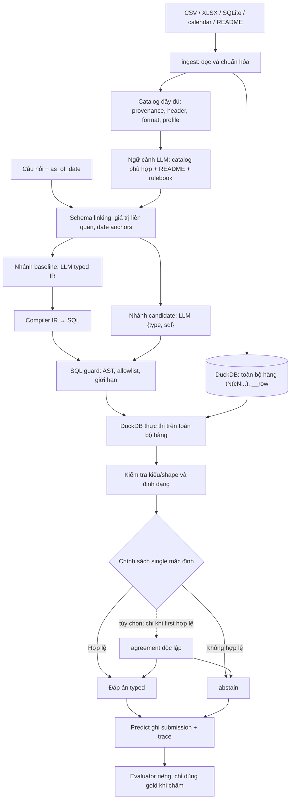

# Kiến trúc và hướng nghiên cứu DataMate — trạng thái phiên 29/10/2026

## Kiến trúc tổng thể



Sơ đồ cho thấy hai nhánh kế hoạch nghiên cứu cùng đi qua một SQL guard và DuckDB, nhưng không phải một chuỗi duy nhất: nhánh typed IR là baseline; nhánh `{type, sql}` là candidate tối giản đang được so sánh. Chỉ catalog/README/rulebook liên quan được đưa vào prompt; toàn bộ hàng ở lại trong DuckDB. Candidate SQL là lựa chọn tạm thời, chưa phải kết luận cuối.

Ở runtime, model được nạp một lần. Sau đó runner xử lý lần lượt từng doanh nghiệp: ingest một lần toàn bộ bảng của doanh nghiệp đó, dựng catalog, chạy các câu hỏi của doanh nghiệp theo batch 4 trên cùng database/ngữ cảnh, rồi đóng database trước khi chuyển sang doanh nghiệp tiếp theo. Các hàng giữa doanh nghiệp không bị trộn và tệp không bị nạp lại cho từng câu hỏi.

### Vai trò các mô-đun

| Mô-đun          | Trách nhiệm                                                                                                                               |
| --------------- | ----------------------------------------------------------------------------------------------------------------------------------------- |
| `ingest.py`     | Đọc nguồn, giữ giá trị ở `VARCHAR`, gắn provenance và metadata định dạng, tạo bảng DuckDB cùng catalog schema.                            |
| `predict.py`    | Điều phối từng câu hỏi, dựng ngữ cảnh, gọi model, áp chính sách chọn/abstain, ghi checkpoint và trace.                                    |
| `engine.py`     | Kiểm tra và thực thi SQL trong DuckDB với giới hạn, định dạng kết quả và từ chối truy vấn không an toàn.                                  |
| `evaluation.py` | So khớp output với gold, tính PA/precision/coverage, bootstrap theo doanh nghiệp và so sánh các phương án. Không được nhập vào inference. |

Một pipeline suy luận dùng các mô-đun trên; evaluator là công cụ chấm riêng, không phải một pipeline suy luận thứ hai.

## 3. Nạp dữ liệu và catalog

### 3.1 Nạp dữ liệu theo hướng lossless

Đầu vào gồm CSV, XLSX, SQLite, `calendar` và README mô tả cột/định dạng/nghiệp vụ. Giá trị nguồn được giữ trong cột `VARCHAR`; kiểu/format metadata hướng dẫn macro chuyển đổi trong lúc truy vấn. Mục tiêu là giữ dữ liệu nguồn nguyên vẹn về mặt giá trị và khả năng truy nguyên, đồng thời tạo một biểu diễn phẳng dễ truy vấn:

- Mỗi bảng hoặc sheet thành bảng DuckDB `tN`; mỗi cột thành tên trung tính `cN`, để tránh tên cột gốc bị trùng, kỳ lạ hoặc gây nhầm khi compiler phân tích.
- Giữ thứ tự hàng bằng `__row`; metadata đi kèm ánh xạ `tN` về tệp, sheet, bảng nguồn, hàng header, định dạng, null và hồ sơ cột. Catalog đầy đủ lưu tên header gốc và mô tả từ README.
- CSV đọc encoding/delimiter; SQLite mở chỉ đọc. XLSX dùng Calamine làm đường nhanh và fallback openpyxl cho công thức, cached errors, số nguyên lớn từ `2**53` trở lên hoặc trường hợp cần giữ cách Excel biểu diễn. So sánh reader đã kiểm tra toàn bộ 176 workbook; 30 lỗi cached của Excel vẫn được giữ nhờ fallback.
- Nhận diện hàng tiêu đề bằng điểm chữ/header thay vì chỉ đếm chữ số. Sửa này bỏ qua các hàng dữ liệu nhiều chữ số vốn bị nhận nhầm là header; vị trí header của các bảng train đã kiểm tra không đổi.
- Nhận dạng số theo thứ tự ưu tiên định dạng nhóm hàng nghìn, phân cách thập phân và ký hiệu tiền phổ biến ở Việt Nam/Anh; ví dụ chuỗi giả lập `1.234.000`, `1,234,000`, `12,5`. Tránh suy đoán số có 5 chữ số là ngày Excel.
- Ngày Việt như `1 thg 6 2025` được nhận diện theo dạng ngày-tháng-năm; ngày không hợp lệ bị từ chối thay vì tự sửa. Ngày thiếu năm phải được xử lý theo rulebook và căn cứ dữ liệu; parser gán năm tổng quát từ tên tệp/sheet chưa được xác thực.
- Bảng cùng cấu trúc được nhận diện bằng header và định dạng, đồng thời giữ nguồn riêng. Phiên bản SQL schema-serialization thử DDL mô tả bảng và bảng rỗng cho layout lặp lại; đó chỉ là metadata để mô hình hiểu schema, không phải ghép hay cắt dữ liệu thật.

Trong ablation DDL, catalog được biểu diễn thành `CREATE TABLE tN (cN VARCHAR, ...)` kèm comment header/format; các bảng lặp layout có thể được khai báo qua `CREATE TABLE t1 AS SELECT * FROM t0 LIMIT 0`. Ba biến thể prompt tăng lần lượt 214, 958 và 1,597 token so với catalog phẳng. Đây là chi phí context đã đo, không phải tuyên bố rằng DDL rút gọn token. Native header alias replay cũng được cân nhắc nhưng không dùng: nó thường phơi ra lỗi kiểu khác hoặc khôi phục một đáp án không đúng.

Đã đọc được 30 doanh nghiệp train, 369 bảng và 4,040,872 hàng. Tối ưu đọc tổng thể cho `biz128` giảm 23.591 xuống 12.592 giây; đây là tốc độ ingest toàn phần, không phải tuyên bố reader thô nhanh 7.7 lần.

### 3.2 Catalog, mẫu và dữ liệu thật

Catalog phục vụ schema linking: kiểu dữ liệu, nguồn, mô tả cột trong README, grain/bố cục bảng, miền giá trị và hồ sơ. Giá trị phân loại ít-cardinality được liệt kê đầy đủ khi tối đa 12 giá trị mỗi bảng; nếu nhiều hơn thì chỉ đưa một số ví dụ. Ví dụ này giúp mô hình chọn bảng/cột nhưng không thay thế dữ liệu: SQL luôn chạy trên toàn bộ bảng.

Các giá trị khớp với thực thể trong câu hỏi được tìm trên cột văn bản và đưa vào ngữ cảnh theo bảng/cột; chúng là manh mối chọn khóa/giá trị, không phải kết quả tổng hợp. Mọi truy vấn vẫn phải tính trên dữ liệu nguồn đầy đủ. Các hàng mẫu hoặc profile thống kê không được dùng làm đáp án.

### 3.3 Ý nghĩa nghiệp vụ, grain và dữ liệu thiếu

Rulebook là hợp đồng ngữ nghĩa chung: doanh thu, trạng thái đơn, trả/hủy, cách tính ngày/kỳ, danh tính khách hàng, đơn vị đo, hàng trùng, hàng tiếp diễn và loại bản ghi. README của từng doanh nghiệp bổ sung ý nghĩa cột, từ viết tắt và quy ước riêng. Khi áp dụng quy tắc trùng, chỉ dòng giống hệt thuộc cùng một đơn mới được gộp; dòng ở đơn khác và log không thuộc đơn phải được giữ. Tie-break dùng mã/code nếu rulebook có; nếu không thì theo tên như rulebook quy định.

Kế hoạch phải phân biệt dòng hàng với đơn hàng: doanh thu thường cộng ở grain dòng; số đơn cần đếm mã đơn phân biệt; khách/ngày/sản phẩm phải đếm đúng grain. Khi một đơn có nhiều dòng, join header-line theo mã đơn, tổng hợp mỗi phía về đúng grain trước khi nối nếu không sẽ nhân bản giá trị, và tránh cộng lặp tổng ở header. Giá trị trống ở dòng tiếp diễn, bản ghi trùng do export, trạng thái hủy/trả từng dòng so với toàn đơn, giá sau giảm, phí giao, đơn vị và chuyển đổi đều có thể làm đổi kết quả. Không có cột hay README đủ căn cứ thì cần abstain thay vì tự suy đoán.

Lịch `calendar` hỗ trợ phép đổi ngày âm/lịch Tết. Các mốc ngày tính từ `as_of_date` đầu vào, không dựa vào đồng hồ máy. Trong candidate phiên đó, bộ anchor Gregorian gồm hôm nay/hôm qua, tháng hiện tại và tháng trước, với khoảng nửa mở `[bắt_đầu, kết_thúc)`; bổ sung này đã qua kiểm tra logic CPU nhưng chưa có lần chạy benchmark 54 câu mới.

## 4. Kế hoạch SQL và kiểu kết quả

### 4.1 Hai dạng đầu ra đã nghiên cứu

Baseline tạo typed IR biểu diễn phép chọn nguồn, lọc kỳ, join, grain, phép tổng hợp và kiểu kết quả; validator/compiler chuyển IR thành SQL. Mục tiêu là biến yêu cầu ngôn ngữ thành thao tác rõ ràng, có thể kiểm tra trước khi chạy. Tuy nhiên, baseline gặp nhiều lỗi tạo/kết nối IR và coverage thấp.

Phương án SQL tối giản yêu cầu một JSON kế hoạch có `{type, sql}`. `type` thuộc `number`, `percent`, `string`, `date`, `boolean`, `list`, `table`, `abstain`; `unanswerable` có `reason` riêng. Với `abstain`, SQL rỗng: `{"type":"abstain","sql":""}`. Kế hoạch `unanswerable` là `{"type":"unanswerable","reason":"..."}`. SQL thực thi trong DuckDB; mô hình không tự cộng số từ mẫu dữ liệu. Đây là biến thể có kết quả thử nghiệm tốt hơn typed IR trong lần so sánh nhỏ cùng 54 câu, nhưng PA vẫn thấp và đang chờ so sánh lại với IR có bounded thinking.

Ví dụ giả lập dùng metadata khai báo `t0.c0` là ngày ISO và `t0.c2` là số định dạng plain; cả hai cột vật lý vẫn là `VARCHAR`. Không chứa câu trả lời thật hoặc ID nghiệp vụ:

```json
{
  "type": "number",
  "sql": "SELECT ROUND(SUM(num_plain(\"c2\"))) FROM \"t0\" WHERE date_iso(\"c0\") >= DATE '2026-04-01' AND date_iso(\"c0\") < DATE '2026-05-01'"
}
```

`abstain` là kế hoạch không trả lời, không phải câu trả lời cuối: nó có dạng `{"type":"abstain","sql":""}`. `unanswerable` trong kế hoạch chỉ mang loại và lý do; sau khi executor/predict xác định output cuối, JSONL mới thêm ID và `answer: null`, ví dụ `{"id":"<id câu hỏi>","type":"unanswerable","answer":null,"reason":"<lý do>"}`. Ví dụ đều giả lập. Executor thực thi và định dạng đáp án; model không tự cung cấp answer cell.

Hai kế hoạch này kết thúc ngay ở predict, không đi qua SQL guard hay DuckDB; schema kiểm tra cấu trúc/lý do nhưng không tự chứng minh ngữ nghĩa rằng dữ liệu thực sự thiếu.

Query chạy được không đồng nghĩa đáp án đúng ngữ nghĩa. Executor kiểm tra cú pháp, quyền truy cập và hình dạng kết quả; nó không chứng minh rằng cột đo, grain, lọc trạng thái, kỳ ngày hay join là đúng.

### 4.2 Guard, thực thi và định dạng

`engine.py` là ranh giới xác định giữa kế hoạch mô hình và dữ liệu. Guard dùng DuckDB AST serialization, không chỉ regex: chặn hàm phụ thuộc thời gian máy (`current_date`, `now`), ngẫu nhiên/UUID, truy vấn động hoặc hàm hệ thống; vẫn giữ đúng quoted identifier, string literal và comment. Truy vấn phải là một SELECT đọc dữ liệu, tham chiếu ít nhất một bảng đã nạp trong allowlist `tN`, không gọi bảng/header mơ hồ và không được chỉ truy vấn hằng số hay catalog hệ thống. DuckDB tắt external access.

Các giới hạn đã đặt trong candidate: tối đa 2 GB bộ nhớ DuckDB, 15 giây cho một query, 5,000 hàng trả ra. Các macro chuyển đổi số/ngày như `num_plain`, `num_vn`, `num_en`, `date_iso`, `date_dmy` chuẩn hóa kiểu và từ chối chuyển đổi mơ hồ/lỗi. Scalar null, số không hữu hạn, kiểu hoặc shape sai đều thành abstain. Kết quả được chuẩn hóa theo kiểu; ngày xuất ISO, phần trăm làm tròn hai chữ số, list/table giữ cấu trúc và nhãn theo yêu cầu.

Abstain và unanswerable được phân biệt. `unanswerable` dành cho điều kiện rulebook như toàn bộ kỳ hỏi nằm ngoài khoảng ngày giao dịch có thật; không được suy luận từ mẫu hoặc README rằng không có bản ghi. Candidate để model đề xuất `unanswerable` từ catalog/schema; schema chỉ kiểm tra hình dạng output, không chứng minh dữ liệu đã được bao phủ hết kỳ hỏi. Không có bước xác minh coverage tổng quát trên toàn bộ nguồn ở phía executor. Vì vậy đây là chính sách candidate có nguy cơ kết luận thiếu dữ liệu sai và cần chạy lại dev54. Khi không đủ căn cứ, dùng `abstain`. Output JSONL cuối của unanswerable có ID, `answer: null` và `reason` ở cấp cao nhất; đó không phải cấu trúc kế hoạch nội bộ của model.

Các sửa đổi rulebook/prompt trong phiên gỡ bỏ lệnh cấm deduplicate quá rộng đối với ledger; thay vào đó chỉ gộp dòng giống hệt trong cùng đơn, vẫn giữ các đơn khác nhau và log không phải đơn. Tie-break dùng code tăng dần khi có, nếu không dùng tên theo rulebook. Một số ràng buộc unanswerable quá hẹp hoặc chỉ xét thiếu cột cũng được nới lại. Đây là thay đổi candidate cần chạy lại full dev54, chưa được xem là cải thiện PA đã chứng minh.

## 5. Chọn đáp án, reasoning và vận hành

### 5.1 Chính sách single/agreement/repair

Chính sách mặc định tạm thời là `single`: chỉ chấp nhận kết quả đầu tiên nếu query chạy, qua guard và tạo đúng kiểu/shape; nếu không hợp lệ thì abstain. Repair một lần sau lỗi thực thi chỉ là một trial điều khiển riêng, không chạy mặc định. Có thể bật `agreement`: chỉ gọi thêm một lần độc lập khi câu trả lời đầu hợp lệ và chỉ trả lời nếu hai kết quả đồng thuận. Abstain nếu kiểm tra thất bại hoặc hai kết quả khác nhau.

Thử nghiệm repair không cải thiện PA trên 54 câu, trong khi agreement toàn bộ abstain khi áp lên nhóm đó. Do đó repair không được bật mặc định và agreement chỉ là tùy chọn. Agreement có thể giúp kiểm soát rủi ro trong tương lai nhưng cần chứng minh bằng coverage/PA trên nhiều câu hơn.

### 5.2 Thinking có ngân sách

Structured output JSON ban đầu chỉ ràng buộc hình dạng, không đồng nghĩa với prompt hữu ích. Khi bật constrained decoding, whitespace dư ngoài chuỗi JSON từng khiến output phình gần giới hạn 7,000 token. Cấu hình engine-level XGrammar `disable_any_whitespace=True` xử lý lỗi này; thiết lập ở cấp request không có hiệu lực tương đương.

Qwen3.5-9B dùng parser `qwen3` của vLLM cho reasoning, phối hợp với parser structured output. Giới hạn output tối đa 7,000 token là tổng của reasoning và JSON, không phải 2,048 cộng thêm 7,000. Với context 24,576, output cap cho prompt là `min(7,000, 24,576 − số_token_input)`; input không bị cắt và prompt bị từ chối nếu không còn ít nhất 512 token cho JSON. Bên trong output cap đó, reasoning tối đa `min(2,048, max(0, output_cap − 512))`; JSON dùng phần output còn lại. Ngân sách này buộc reasoning kết thúc bằng `</think>` trước khi sinh JSON. Hệ thống trích JSON theo token ID sau lần `</think>` cuối, không tìm bằng regex văn bản mù. Thiếu marker kết thúc, output bị cắt hoặc JSON lỗi thì abstain. CLI candidate chỉ bật thinking khi có cờ. Prefix caching bật; seed 0, temperature 0.6, top-p 0.95, top-k 20, presence penalty 0, context 24,576, batch 4.

Thinking không giới hạn bị dừng ở 9/54: 3 output chạm 7,000 token trước marker kết thúc và cả 9 abstain. Thinking bounded 2,048 hoàn tất 54/54 nhưng PA bằng non-thinking ở mức 0.01852, trong khi thời gian LLM cao hơn 5.63 lần. Vì vậy mặc định tại thời điểm dừng vẫn là **không bật thinking**; đây là quyết định tạm dựa trên PA và chi phí quan sát được.

### 5.3 Checkpoint và triển khai offline

Trước khi khởi tạo model, runner ghi submission gồm toàn bộ ID đã chọn với trạng thái abstain bằng thao tác atomic. Sau đó cập nhật theo batch; nếu timeout/lỗi, checkpoint vẫn là JSONL hợp lệ. Shell timeout là 21,480 giây kèm 15 giây grace trước kill. Docker chạy offline (`--network none`) với model được mount/copy cục bộ và biến môi trường tắt tải model/thống kê bên ngoài.

Môi trường nghiên cứu dùng Qwen/Qwen3.5-9B, revision `c202236235762e1c871ad0ccb60c8ee5ba337b9a`, 9,653,104,368 tham số, vLLM 0.32.0, Transformers 5.19.0, DuckDB 2.0.0, trọng số BF16. Phần cứng bench là **một RTX A5000 24 GB (GPU1)**. Máy có ba A5000; GPU0/GPU2 được các công việc khác dùng nên không đụng đến. Không có phép đo trên 2 RTX 5090, và không suy ra thời gian hoàn tất trên cấu hình đó. Docker nghiên cứu cũ khoảng 68 GB, nhưng image/source Docker cuối chưa hoàn thiện tại thời điểm dừng.

Không có API suy luận ngoài, không ensemble hay checkpoint phụ được chọn. Qwen3-14B chỉ là phương án dự phòng đang cân nhắc: manifest thử nghiệm pin revision `40c069824f4251a91eefaf281ebe4c544efd3e18`, 14,768,307,200 tham số; kiểm tra model và suy luận GPU còn pending. Chưa dùng nó làm model chính.

## 6. Đánh giá và kết quả

### 6.1 Chia tập và quy trình chấm

Fold được chia theo doanh nghiệp, seed 20261027; các câu của một doanh nghiệp không bị rải giữa fold train/dev. Dev chính là fold 2, 3, 4: 18 doanh nghiệp, 54 câu, hash ID `17163cb6c46fe18d46262ee5445bf0050e8256f1098268b441bcf14a05d75f27`. Fold 1 (6 doanh nghiệp, 18 câu) dành cho calibration.

Ban đầu eval là 30 câu của fold 0; trước khi mở gold, nó được mở rộng và đóng băng thành 120 câu: 6 doanh nghiệp, 20 câu mỗi doanh nghiệp được chọn theo SHA256 của `0:<question-id>`. Hash tập câu là `550be04431278cdd8d490cb45805112ea749059091a424e0747a28d4971fbe8c`. Không đọc gold của eval120 trong phiên; gold không được đưa vào prompt. Doanh nghiệp vẫn từng xuất hiện trong train lịch sử, vì vậy đây là business-separated retrospective evaluation, không phải benchmark độc lập tuyệt đối.

Evaluator mô phỏng quy tắc chấm đã công bố, không phải scorer ẩn chính thức. Nó dùng đúng tập ID làm mẫu số, coi thiếu prediction là abstain và có bootstrap theo cụm doanh nghiệp/so sánh cặp. Phân bố gold của dev54: 35 number, 10 percent, 4 date, 3 list, 1 boolean, 1 unanswerable, 0 table.

### 6.2 Bằng chứng thực nghiệm đến lúc dừng

| Thử nghiệm                               | Kết quả trên cùng dev54                                                                                                                           | Thời gian và lưu ý                                                                                                                                |
| ---------------------------------------- | ------------------------------------------------------------------------------------------------------------------------------------------------- | ------------------------------------------------------------------------------------------------------------------------------------------------- |
| IR ban đầu, single-first                 | 1 đúng, 4 sai, 49 abstain; PA −0.05556, precision 0.20, coverage 0.09259                                                                          | 1,490.64 giây cho first + agreement, chưa gồm 234.21 giây khởi tạo model; không phải latency của single.                                          |
| IR Docker khớp cấu hình, non-thinking    | 1 đúng, 2 sai, 51 abstain; PA −0.01852, precision 0.3333, coverage 0.05556                                                                        | 764.62 giây không kể model init dùng chung; LLM 596.91 giây.                                                                                      |
| SQL tối giản, non-thinking, single-first | 1 đúng, 0 sai, 53 abstain; PA +0.01852, precision 1.00, coverage 0.01852                                                                          | LLM 190.82 giây. Đây là PA cao hơn IR trong so sánh khớp 54 câu, nhưng chỉ có một đáp án được trả lời.                                            |
| SQL + repair/agreement                   | Repair trên các first answer tương ứng: 2 đúng, 2 sai, 50 abstain; PA 0, precision 0.5, coverage 0.07407. Agreement: 0 đúng/sai, 54 abstain; PA 0 | Repair thêm 50 request, 143.51 giây LLM; agreement thêm 1 request, 1.84 giây. Trial wall 507.14 giây bao gồm các phase, không phải độ trễ single. |
| SQL + thinking bounded 2,048             | 6 đúng, 5 sai, 43 abstain; PA +0.01852, precision 0.54545, coverage 0.20370                                                                       | LLM 1,073.95 giây; 1,452.93 giây kể cả init. 54/54 có marker kết thúc, không bị cắt; PA bằng non-thinking dù coverage tăng.                       |
| SQL + thinking không giới hạn            | 0/9 trả lời; 9 abstain                                                                                                                            | Dừng thử nghiệm ở 9/54; 3/9 chạm trần 7,000 token. Không phải kết quả full-dev.                                                                   |

Năm nhóm lỗi của bounded-thinking có bằng chứng: kỳ tương đối biến thành lọc `LIKE` sai; chọn nhầm cột doanh thu hoặc tính cả giảm giá/phí giao; đếm dòng thay vì `COUNT(DISTINCT order)`; bỏ lọc tháng được gọi tên; chuyển đổi locale/đơn vị sai hệ số 1,000. Không có join trong năm lỗi đó. List/date/boolean/unanswerable đều abstain; dev không có câu table. Precision 1.00 của non-thinking là trên đúng **một** đáp án, không phải bằng chứng precision ổn định.

Các phương án sửa semantics, ngày Việt, unanswerable, guard AST, schema serialization và date anchors đã qua một phần kiểm tra CPU/review. Chúng chưa có benchmark canonical mới trên đủ 54 câu. Theo snapshot cuối cùng tôi đã xác nhận tại mốc này, bản DDL non-thinking đang chạy dở ở 24/54; job so sánh fair giữa IR+bounded-thinking và SQL hiện tại đang chờ. Không gán kết quả chưa có hoặc các kết quả lưu xuất hiện sau cutoff cho trạng thái tại đây.

